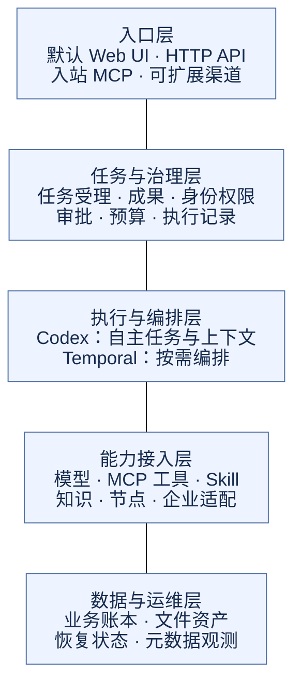
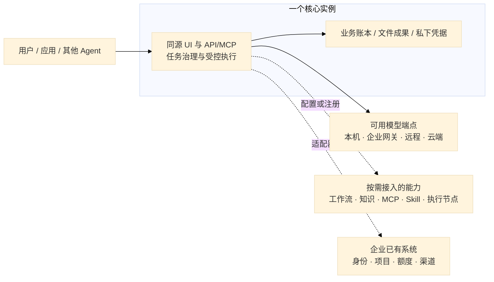

# AgentOS 总体架构

> 版本：3.1
> 更新日期：2026-10-01
> 文档性质：逻辑分层与部署边界
> 适用范围：可自托管的 AI 集成与治理底座
> 阅读入口：[文档目录](README.md)

## 1. 架构目标

AgentOS 把已有模型、Agent、知识、工具、技能、身份与业务系统连接起来，提供统一任务、权限、审批、成果与成本视图。Web 工作台是默认入口，HTTP 和 MCP 让其他应用与 Agent 使用同一底座。

产品按“一个核心，能力按需接入”设计。接入功能和部署位置分别配置：同机服务、远程服务、企业已有系统与云端服务可以组合使用，操作系统、设备型号和机器数量不构成产品要求。逻辑分层不意味着每层都要拆成一个服务。

## 2. 总体分层

这是职责分层，由上至下展示层次，不作为执行时序；具体调用、审批和预算顺序放在 [执行模块](modules/execution.md)，能力发现与工作流节点放在 [能力接入模块](modules/capabilities.md)。总图不承担 RPC、字段或组件内部调用说明。

| 层 | 负责什么 | 实现与边界 |
| --- | --- | --- |
| 入口 | 用户、应用和其他 Agent 提交及查看任务 | FastAPI 同源 UI、HTTP、官方入站 MCP 已有；真实 IM 后置 |
| 任务与治理 | 统一资源、执行身份、审批、预算、幂等与成果 | AgentOS 保留业务差异与治理规则；企业身份通过 Authlib/PyJWT 接入 |
| 执行与编排 | 自主选择工具，或执行确定的业务流程 | Codex 承载真实推理与上下文；Temporal 按需承载持久工作流 |
| 能力接入 | 通过协议与 Adapter 复用既有能力 | MCP/Skill/Knowledge/Node 等 Port；统一目录包含固定工作流启动与 MCP 外部 Agent；其他协议经 Adapter 扩展 |
| 数据与运维 | 保存状态与效果、恢复、追踪与部署配置 | 当前单核心 SQLite/文件资产；OTel 只发元数据，多核心与 HA 待验 |

## 3. 核心与可选能力

核心提供工作台、API/MCP 入口、任务/成果、权限/审批/预算和持久账本。真实自主任务需要 Codex 与可用模型端点；未配置时仅能运行明确标注的 scripted 验证。

| 能力 | 是否需要单独部署 | 当前可配置情况 |
| --- | --- | --- |
| Web UI | 随核心同源提供 | 默认工作台已有；可视编辑器构建见部署指南 |
| 模型 | 可连接已有服务或云端 | 通过端点、模型名、凭据和出域策略配置；LiteLLM 可选 |
| 固定工作流 | 接入既有或自行部署 Temporal | 不配置地址可运行普通任务；持久图工作流需要 Temporal |
| 知识 | 可连接已有知识系统 | 可选择 disabled / builtin / weknora；关闭后目录、工具和 UI 同步 |
| 工具、技能、执行节点 | 随需安装或连接 | MCP 注册后发现工具；Skill 安装、节点配对均受权限约束 |
| 企业身份 | 连接企业已有系统 | 本地身份可启动；OIDC/ID4/JWT 是可选接入通道 |
| 项目、额度、渠道 | 复用旧系统与协议 | Port 已留，真实业务适配按需求后续实现 |

知识关闭、工具发现状态、目录同步与参数表单已实现；固定工作流启动、MCP 外部 Agent 与受控接入草稿已接通，其他协议按 [开发计划](04-开发计划.md) 推进。

## 4. 部署形态

方框表示职责，不固定机器：所有组件可以同机，也可以连接多台机器上的已有服务。当前支持一个核心实例连接外部服务/节点；核心多副本共享状态、自动资源调度、生产高可用尚未验收。外部能力断开时应明确报告不可用，不能擅自扩大权限或静默改用不同数据边界的服务。

配置方式见 [集成部署](09-集成部署.md)，访问、备份和恢复见 [部署与运维](05-部署与运维.md)。个人联验环境只作为本地验证记录保存，不作为用户必须照搬的部署模板。

## 5. 模块与依赖方向

| 目录 | 职责 |
| --- | --- |
| `kernel/` | 类型、状态机、Port 与存储协议 |
| `runtime/` | 引擎驱动、Worker、步骤执行和恢复 |
| `services/` | 任务、成果、身份、审批、知识等业务服务 |
| `adapters/` | 模型、存储、知识、MCP、工作流与节点实现 |
| `apps/` | 网关、入口、配置与组合根 |
| `frontend/` | 默认工作台与可视工作流编辑器 |

`kernel` 不依赖具体实现，`runtime` 不导入 `adapters/apps`，由组合根配置实现。成熟开源件负责通用引擎；业务治理和必要适配的保留理由见 [开源取舍](08-集成底座改造方案.md#10-开源优先复核与保留例外)。

## 6. 自主执行与工作流

普通任务不要求用户先画流程：Codex 读取平台提供的工具描述与参数 schema，选择合适工具，所有调用仍经过服务端核权、审批、预算和效果账本。可选择目录内的固定版本工作流启动或 MCP 外部 Agent；不会自动生成流程、配置外部服务或加载全机 Skill。

固定工作流用于需要明确节点、业务顺序、分支或持久等待的任务。MCP 工具可从统一目录选择，参数表单使用 RJSF/AJV，编辑器定期同步接入变化，发布固定契约；已发布工作流可作为固定版本能力启动，外部 Agent 经 MCP 工具调用；Skill 保持固定版本资源语义，不伪装成函数。选择路径与缺口详见 [能力接入模块](modules/capabilities.md)。

## 7. 治理与扩展约束

发现能力只代表“知道它存在”，执行仍由平台核权。已有授权内的只读动作可直接执行；写入、执行、费用或数据出域按策略审批，参数改变重新裁定。权限不足、预算不足、服务断开或结果未知可能导致拒绝/暂停，并非只需用户点击授权就一定能继续。

成果不可变，效果账本绑定稳定步骤键；已确认成功不重放，未知结果先对账。撤权后拒绝后续读取和派发，已下载数据无法远程收回。凭据、内部路径和私有正文不进入公开投影。

新增能力优先通过标准协议与 Adapter 接入，保持一个核心和统一治理路径。企业已有框架优先，其次是成熟开源组件；当前实现与待办由 [开发计划](04-开发计划.md) 裁定，接口、状态与验证见 [工程设计](02-工程设计.md)。
