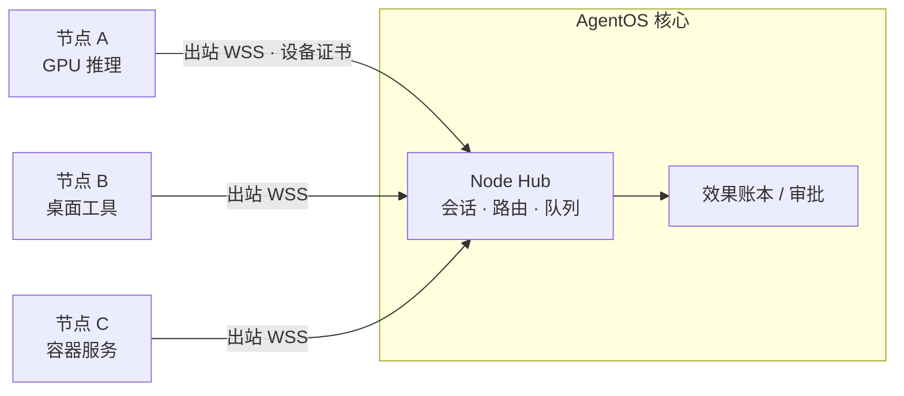

# AgentOS 成熟化升级方案

> 版本：1.0
> 更新日期：2026-10-23
> 文档性质：成熟度诊断与分阶段落地方案（待确认，不构成实施授权）
> 适用范围：开源核心的产品化、全链路打通、界面改造与开源治理
> 阅读入口：[文档目录](README.md)

## 1. 结论摘要

AgentOS 的治理内核已经比同类个人项目扎实：服务端裁定授权/审批/预算/出域，效果账本 + 稳定幂等键 + 对账，Port/Adapter 与 import-linter 约束依赖方向，mypy strict、700+ 测试、契约导出、Gitleaks 门禁齐全。这些是同类开源平台（Dify、n8n、OpenHands 等）里不常见的长处，后续升级应保留，不重写。

不成熟之处集中在四个方面：

1. **“入口 → 成果”链路两端偏弱**：入口只有 Web/HTTP/MCP/Webhook/Cron，缺 IM 渠道和工作流定时触发；成果只能停在成果库，缺“交付到哪里、谁验收、是否通知”。中间的执行治理很强，两端却还没打通。
2. **设备与执行节点仍是“配对 + 静态令牌 + 网关反向调用节点 HTTP”**：节点需要开放入站端口，没有在线状态推送、逐设备凭据轮换、执行白名单和队列可视化。对“连接多台异构设备”的定位来说，这是最大的结构性缺口。
3. **工程产品化**：没有版本标签、发布物和 CHANGELOG；`gateway.py`（约 1900 行）和 SQLite 存储（约 2200 行）是单文件巨块；迁移靠逐列 `ALTER` 判断；演示/访客和一个垂直制作域（AIGC）直接放在核心里。
4. **界面**：阅读层次在 UI-02 后已经清楚，但仍以 4 秒轮询代替实时流；缺设备/运行中心这类“全管控”视图；首次安装开箱即失败；有几处明显的视觉与降级缺陷（见第 6 节）。

本文按“先卫生与安全、再设备连接、再全链路、再可观测与生态”分五个阶段推进，每项都写明要改的文件、验收标准和可参考的成熟开源项目。状态与排期最终仍以 [开发计划](04-开发计划.md) 为准。

## 2. 诊断方法与证据

| 方式 | 内容 |
| --- | --- |
| 源码核对 | 以 `main` 当前提交为准，统计模块规模、路由数量、存储迁移方式、前端轮询与流式实现、节点调用方式 |
| 干净安装实测 | 公开仓库干净克隆，`uv sync --frozen` 后无配置启动；`pytest` 全部通过；用 Playwright 在 1440×900 和 390×844 视口截图首页、任务、能力中心、工作流、制作页 |
| 公开仓库隐私扫描 | 对已跟踪文件和全部 Git 历史检索私网地址、本机用户路径、邮箱、密钥样式；未发现硬性泄露（见第 8 节） |
| 社区对标 | 参考 2026 年仍活跃的开源/标准：MCP 2026-07-28 规范、A2A 1.0、AG-UI、OpenTelemetry GenAI 语义约定、OpenClaw 网关/节点模型、Dify/n8n/LangGraph、Temporal、Tailscale/Headscale、Langfuse |

本文的截图与实测只用合成数据，不作为真实模型或真机验收证据。

## 3. 成熟度评估

按“入口 → 受理 → 规划 → 执行 → 治理 → 成果 → 交付 → 复盘”八段链路评估。等级：L1 原型可用；L2 单机可靠；L3 有治理与恢复；L4 可运维、可观测、可升级；L5 生态化、可多实例。

| 链路段 | 现状 | 等级 | 主要缺口 |
| --- | --- | --- | --- |
| 入口 | Web、HTTP、入站 MCP、Webhook、Cron、语音 | L2 | 无 IM 渠道；工作流无定时/事件触发；无统一“入口状态”视图 |
| 受理 | 目标 + 材料 + 模板；稳定幂等 | L3 | 材料限文本类、单份 64 KiB；无图片/PDF/表格解析通道 |
| 规划 | Codex 自主选择工具；固定版本工作流 | L3 | 计划对用户不可见（只显示“未保存结构化计划”）；单一推理运行时 |
| 执行 | 本地沙箱、MCP、节点、Temporal | L2 | 节点入站 HTTP + 共享令牌；无在线推送、队列/资源可视；长任务 2400 秒同步等待 |
| 治理 | 核权、审批、预算、出域、账本、对账 | L4 | 规则只在代码里，缺可读的策略文件与策略测试 |
| 成果 | 不可变 Asset、版本续改、预览 | L3 | 无缩略图/媒体网格、无来源图谱、无验收状态 |
| 交付 | 下载、签名链接 | L1 | 无“交付目标”（目录/设备/渠道/邮件）与通知 |
| 复盘 | 事件、脱敏用量、OTel 元数据 | L2 | 无成本面板、无质量评测回归、无回放对比 |

## 4. 架构与代码升级

### 4.1 网关拆分为领域路由

**现状**：`src/agentos/apps/gateway.py` 在一个 `create_app` 内联约 99 个路由，`Depends` 只出现 5 次，演示、认证、知识、节点、成果混在一起。

**做法**：按领域拆成 `apps/routes/{tasks,assets,capabilities,workflows,knowledge,nodes,auth,demo}.py`，每个文件一个 `APIRouter`；鉴权、当前主体、租户通过 `Depends` 注入；OpenAPI 加 `tags` 与 `operationId`。同时由 OpenAPI 生成前端类型（`openapi-typescript`），替代手写 `frontend/js/api.js` 中的路径常量。

**验收**：`gateway.py` < 300 行，只保留装配；契约导出无漂移；现有 API 行为测试全部通过。

### 4.2 存储迁移版本化

**现状**：`adapters/store/sqlite.py` 用 `CREATE TABLE IF NOT EXISTS` + 逐列探测 `ALTER TABLE`，没有迁移版本号；回滚和多副本时无法判断库的结构版本。

**做法**：引入编号迁移（`migrations/0001_*.sql` + `PRAGMA user_version`，或采用 Alembic + SQLAlchemy Core）。存储实现按聚合拆分（runs/steps、assets、identity、catalog、demo）。如果后续需要多副本，可在同一迁移体系下增加 PostgreSQL Adapter。

**验收**：旧库自动升级到最新版本号；`--check` 能报告待执行迁移；升级前自动执行 SQLite 在线备份。

### 4.3 核心瘦身：演示与垂直域插件化

**现状**：`services/demo.py`（约 1000 行）和 demo 三张表在核心存储；`public_demo_enabled` 默认开启。AIGC 制作（配方、导演、媒体适配器、前端页面）在核心内，导航在没有制作能力时也显示，并带有特定操作系统的文案。

**做法**：

- 定义扩展点：Python `entry_points`（`agentos.extensions`）注册服务、工具、路由、迁移和前端导航项；前端按 `/v1/extensions` 返回结果动态挂载导航。
- 把 AIGC 拆成独立包 `agentos-media`（或放在 `extensions/media/`，单独 wheel），核心只保留通用的“长任务媒体工具”契约。
- 演示/访客拆成 `agentos-demo` 扩展，`public_demo_enabled` 默认改为 `false`（安全默认）。

**验收**：不安装扩展时，核心测试、wheel 和镜像中不含 AIGC/演示代码，导航不出现对应入口；安装后行为与现在一致。参考 Dify 插件体系和 n8n 社区节点的分发方式。

### 4.4 推理运行时去单点

**现状**：真实推理依赖 Codex app-server 的实验性动态工具协议并固定 0.159.2。上游协议一旦变更，核心就失去真实执行能力。

**做法**：保留现有 `AgentRuntime` Port，再补一个不依赖 CLI 子进程的运行时 Adapter（可选 OpenAI Agents SDK、Pydantic AI 或 LangGraph，按许可与维护活跃度在 ADR 中裁定），所有运行时共用一套一致性测试（工具调用、审批暂停/恢复、压缩、限流）。Codex 升级改为 Renovate 自动提 PR + 一致性测试把关。

**验收**：同一组黄金任务在两个运行时上都通过；切换只改配置。

### 4.5 实时事件流与 AG-UI 对齐

**现状**：服务端已有 `/v1/tasks/{id}/stream` SSE，前端仍用 4 秒轮询 + 指数退避刷新整页数据。

**做法**：任务页改用 SSE 增量事件（断线后用 `seq` 补拉 `/events`）；事件类型对齐 [AG-UI](https://www.copilotkit.ai/blog/introducing-ag-ui-the-protocol-where-agents-meet-users) 的 run 生命周期、文本增量、工具调用、状态快照/增量，外部前端或 IM 机器人可以直接复用。列表页保留低频轮询。

**验收**：任务进行中首字节延迟 < 1 秒；断网 30 秒恢复后事件无缺失、无重复。

### 4.6 协议跟进

| 协议 | 现状 | 动作 |
| --- | --- | --- |
| MCP | 官方 SDK，双向 | 跟进 [2026-07-28 规范](https://modelcontextprotocol.io/specification/latest/changelog)：无状态请求、`server/discover`、`subscriptions/listen`、tasks 扩展（长任务）、`_meta` 中传递 `traceparent`；SDK 升级前用合成服务跑兼容测试 |
| A2A | 明确不在范围 | A2A 已发布 1.0 并进入主流云平台（[Linux Foundation 公告](https://linuxfoundation.org/press/a2a-protocol-surpasses-150-organizations-lands-in-major-cloud-platforms-and-sees-enterprise-production-use-in-first-year)）；建议第 5 阶段做出站 A2A Adapter（作为一种工具），入站暂缓 |
| AG-UI | 无 | 见 4.5 |
| OTel GenAI | 只发元数据 | 采用 `invoke_agent` / `chat` / `execute_tool` span 结构；属性仍处 Development 状态，按开关双发 |

## 5. 设备与执行节点升级

这是“连接多台异构设备、全管控”定位的核心缺口，优先级最高。

### 5.1 现状

`apps/node_agent.py` 在每台设备上起一个 FastAPI 服务；网关通过 `adapters/tools/node_hub.py` 主动 `POST {endpoint}/execute`，用共享 Bearer 令牌鉴权，单次调用超时 2400 秒。问题：

- 每台设备都要开放入站端口，跨网段/手机热点/NAT 后面的设备难以接入。
- 在线状态依赖探针，不是实时状态；网关不知道设备忙闲、显存与队列。
- 令牌是长期共享秘密，没有逐设备签发、轮换与吊销记录。
- 节点侧没有命令/工具白名单与本地审批（参考 OpenClaw 的 exec approvals）。

### 5.2 目标模型

参考 [OpenClaw 的网关/节点结构](https://www.heyuan110.com/posts/ai/2026-02-14-openclaw-architecture-deep-dive/)（节点以 `role: node` 握手连到网关的 WebSocket，网关转发工具调用，配对需设备批准）：

| 项 | 设计 |
| --- | --- |
| 连接方向 | 节点主动出站连接网关 WSS（或 gRPC 双向流），网关不再访问节点端口 |
| 身份 | 配对码一次性换取逐设备凭据（短期访问令牌 + 刷新），可吊销、可轮换；可选 mTLS |
| 能力声明 | 节点上报带版本和哈希的能力清单（工具、资源：CPU/GPU/显存、队列深度） |
| 调度 | 网关按能力、在线、负载选择节点；长任务使用作业句柄 + 进度事件，不同步阻塞 40 分钟 |
| 本地护栏 | 节点配置工具白名单、工作目录、资源上限，敏感工具在节点侧也可要求本地确认 |
| 网络 | 建议部署方使用 Tailscale/Headscale 等覆盖网络；核心不依赖它，只要求能出站访问网关 |

**兼容**：保留现有 HTTP 派发作为 `transport=http-legacy`，新节点默认 WSS；已配对节点可在线升级。

**验收**：节点在 NAT 后可接入；拔网线 60 秒内状态变为离线；离线期间派发进入等待而非失败；吊销后已建立的连接 5 秒内断开；结果未知仍走对账。

### 5.3 设备安装体验

提供 `agentos node install` 命令，按系统生成服务定义：macOS `launchd`、Linux `systemd`、Windows 服务（WinSW）。配对流程：网关界面显示配对码/二维码 → 节点执行 `agentos node pair <code>` → 管理员在界面批准 → 设备出现在“设备”页。

## 6. 界面改造

### 6.1 实测问题（干净安装）

| 问题 | 位置 | 影响 | 修复 |
| --- | --- | --- | --- |
| 首次运行即失败 | 无配置时提交自然语言目标，任务显示“模型调用未完成” | 开源用户第一印象是坏的 | 首次启动向导：配置模型端点 → 测试连接 → 运行示例；scripted 模式在顶部明示“演示模式”并只放可成功的示例 |
| 工作流页崩溃 | 编辑器未构建时显示原始英文报错 “Failed to fetch dynamically imported module” | 源码安装用户无法理解 | 捕获加载失败，显示“可视编辑器未构建”+ 构建命令；列表与已发布版本只读查看仍可用 |
| 侧栏背景截断 | 长页面滚动后侧栏底色停在首屏高度 | 视觉破损 | 侧栏用 `position: sticky; height: 100dvh`，主区独立滚动 |
| 复选框异常 | 能力中心“显示示例工具”渲染成大灰块 | 视觉破损 | 统一表单控件样式 |
| 文案语言混杂 | 部分工具描述为英文 | 不一致 | 工具描述走 i18n 资源，缺译时标记 |
| 垂直功能常驻导航 | 未接入制作能力时仍显示“AIGC 制作” | 干扰、泄露部署偏好 | 导航由扩展/能力动态注册（见 4.3） |
| 深色为默认 | 系统为浅色时仍显示深色 | 与规范“随外观适配”不符 | 默认跟随 `prefers-color-scheme` |

### 6.2 信息架构调整

现有导航：新任务 / 任务空间 / 成果库 / 能力中心 / 工作流。要做到“全管控”，建议调整为：

| 一级入口 | 新增/调整 | 内容 |
| --- | --- | --- |
| 新任务 | 调整 | 输入框 + 模板（来自已发布工作流）+ 最近；增加 `⌘K` 命令面板 |
| 任务 | 调整 | 列表改为可排序表格：状态、执行设备、耗时、费用、成果数、更新时间；筛选与批量操作 |
| 收件箱 | 提升为一级 | 审批、补充信息、验收、失败集中处理（参考 [LangChain Agent Inbox](https://www.langchain.com/blog/introducing-ambient-agents)） |
| 成果 | 调整 | 媒体缩略图网格、版本树、来源图谱（输入材料 → 任务 → 步骤 → 成果）、“交付到…”按钮 |
| 设备 | 新增 | 设备卡片：在线、最近心跳、系统/版本、GPU/显存、队列、最近错误；配对与吊销 |
| 能力 | 调整 | 卡片改为紧凑列表，按来源分组（核心/MCP/设备/工作流/扩展）；健康徽标 |
| 自动化 | 新增（合并工作流） | 工作流 + 定时/事件触发 + 入口渠道配置 |
| 运行中心 | 新增（管理员） | 实时运行、队列、费用趋势、错误率、审计检索 |

### 6.3 任务页三栏

宽屏采用“对话 | 计划与步骤 | 成果预览”三栏，窄屏折叠为标签：

- **计划清单**：把运行时的计划实时显示为勾选清单（参考 Claude Code / Manus 的 todo 视图），用户能看到“接下来要做什么”。
- **步骤卡片**：工具名、执行设备、耗时、费用、状态；点开看参数与结果（JSON 留在高级详情）。
- **审批卡片**：内嵌在对话流，显示将执行的动作、关键参数差异、影响范围、确认作用域；参数变化需重新确认。
- **成果预览**：生成中即可预览中间结果，完成后显示“验收 / 要求修改 / 交付到…”。

### 6.4 前端技术路线

当前主体是原生 ES 模块 + 手写 CSS（两份样式表合计约 100 KB），工作流编辑器已使用 React 19 + Vite + RJSF。建议：

- 新增的复杂视图（设备、运行中心、任务三栏）用已有 Vite 工具链按“岛”方式实现，与编辑器共享组件和设计变量；旧页面按需迁移，不做一次性重写。
- 设计变量收敛为一份 `tokens.css`（颜色、间距、圆角、阴影、字体），深浅主题只换变量。
- 引入 i18n（中文为默认，英文为开源用户补齐）。
- 端到端视觉回归：Playwright 在四种视口截图并与基线比对，接入 CI。

## 7. 全链路打通：入口与交付

### 7.1 入口

| 入口 | 动作 | 参考 |
| --- | --- | --- |
| IM 渠道 | 实现现有渠道 Port：飞书/企业微信/钉钉/Telegram 任选两个先做；消息 → 受理；审批卡片回传；成果以链接交付 | OpenClaw 渠道 Adapter 的规范化消息模型 |
| 定时与事件 | 工作流触发统一走 Temporal Schedules；Webhook 统一受理后可绑定已发布工作流 | Temporal Schedules、n8n Trigger 节点 |
| 文件投递 | “监控目录”入口：设备节点上的指定目录出现新文件即创建任务 | n8n Local File Trigger |
| 邮件 | 后置；IMAP 拉取 → 受理 | — |

### 7.2 交付与验收

新增 `Delivery` 概念：成果登记后可按策略交付到目标（设备目录、对象存储、IM 会话、Webhook、邮件），交付本身是带审批与账本的副作用。成果增加验收状态（待验收 / 已接受 / 要求修改），接受后才算闭环。通知通过渠道或 ntfy 等推送服务。

**验收**：一个 IM 消息发起的任务，最终成果自动回到同一会话；用户在 IM 中完成审批与验收；全过程在任务页可回放。

## 8. 安全与开源隐私

### 8.1 公开仓库扫描结果

| 检查 | 结果 |
| --- | --- |
| 已跟踪文件中的私网地址、本机用户路径、邮箱、密钥样式 | 未发现（测试中 `/Users/private` 为合成泄露样例） |
| 全部 Git 历史中的同类模式 | 未发现 |
| 个人过程叙述 | `docs/dev-notes.md` 与开发计划第 7 节包含具体制作过程、听审意见、设备清理数量等现场记录，属于部署方过程信息 |
| 部署偏好 | 制作模块文案与配方默认绑定特定操作系统与具体作品类型 |

**动作**：

1. 把现场过程叙述迁到部署仓库，核心的 dev-notes 只保留通用交接模板与代码层面的结论。
2. 在 `.gitleaks.toml` 增加自定义规则：私网网段、`/Users/<name>`、`C:\Users\<name>`、内网主机名后缀；保留 `useDefault`。
3. `scripts/check_privacy.py` 支持读取部署方提供的**本地**敏感词清单（环境变量指向私有文件，清单本身不入库），提交前钩子同时检查人名、设备名、项目代号。
4. CI 增加 `git log -p` 全历史扫描（Gitleaks `git` 模式），防止通过历史提交泄露。

### 8.2 安全默认值

| 项 | 现状 | 建议 |
| --- | --- | --- |
| 登录暴力破解 | `/v1/auth/login` 无限速 | 按来源与账号限速 + 递增冷却；审计失败登录 |
| 刷新令牌 | “保持登录”时存 `localStorage` | 改为 `HttpOnly; Secure; SameSite=Strict` Cookie（同源部署天然适配），访问令牌留内存 |
| 安全响应头 | 静态页与 API 无 CSP、`X-Frame-Options`、`Referrer-Policy` | 增加中间件，CSP 禁止内联脚本 |
| 初始密码文件 | `owner_password.once` 在首次登录后仍留在数据目录 | 首次登录成功后删除并记审计；启动时若仍存在给出警告 |
| 访客 | 免登演示默认开启 | 默认关闭，由管理员显式开启 |
| 身份 | 单一 owner 密码 | 后续支持 Passkey（WebAuthn），企业仍走 OIDC |

## 9. 可观测与质量

- **链路追踪**：按 OTel GenAI 约定输出 `invoke_agent → chat / execute_tool` 树；可选导出到自托管 Langfuse 或 Arize Phoenix。内容采集默认关闭，与现有出域规则一致。
- **成本面板**：按任务/模型/设备/日聚合 token 与费用，预算消耗趋势。
- **质量回归**：建立 20–50 条黄金任务（材料报告、CSV 检查、审批暂停、断网恢复、越权拒绝），CI 用 scripted 跑确定性部分，夜间用真实模型跑并记录分数；运行时或模型升级必须不降分。
- **回放**：任意已完成任务可用新模型/新运行时“影子重跑”（只读工具、不产生副作用），对比成果差异。

## 10. 开源治理与发布

| 项 | 现状 | 动作 |
| --- | --- | --- |
| 版本 | 无标签/发布物，部署方按 Git 修订引用 | SemVer + `release-please` 生成 CHANGELOG 与标签；发布 wheel 与 GHCR 多架构镜像（amd64/arm64）、SBOM（Syft）与签名（cosign） |
| 依赖 | 前端锁文件 107 处解析地址指向国内镜像 | 锁文件统一为 `registry.npmjs.org`；镜像加速只放在本地 `.npmrc`，否则海外 CI 与贡献者 `npm ci` 受影响 |
| 自动更新 | 无 | Renovate（Python、npm、Docker、Codex 版本） |
| 社区文件 | 仅 README | `CONTRIBUTING.md`、`SECURITY.md`（漏洞报告渠道）、Issue/PR 模板、`CODE_OF_CONDUCT.md` |
| 文档 | 中文、台账式、否定句多 | 按 Diátaxis 分为教程/操作指南/参考/原理；MkDocs Material 生成站点；README 增加英文摘要与 30 秒截图 |
| 许可 | Apache-2.0，`contracts/oss-licenses.json` | 保持；新增依赖时由 CI 校验许可清单 |

## 11. 分阶段路线

每个阶段结束都要跑完整门禁（ruff、mypy、lint-imports、pytest、契约、依赖、文档、隐私、编辑器构建、wheel 校验）。

| 阶段 | 周期 | 编号 | 内容 | 验收 |
| --- | --- | --- | --- | --- |
| P0 卫生与安全基线 | 1 周 | MAT-01 | 过程叙述迁出、Gitleaks 自定义规则与全历史扫描、本地敏感词清单 | 公开仓库无现场叙述；CI 全历史扫描通过 |
| | | MAT-02 | 登录限速、HttpOnly 刷新 Cookie、安全响应头、初始密码文件清理、访客默认关闭 | 对应安全测试新增并通过 |
| | | MAT-03 | npm 锁文件改官方源、SemVer 标签与 CHANGELOG、首个 `v0.2.0` 发布物 | 干净网络 `npm ci` 通过；部署方可按版本号安装 |
| | | MAT-04 | 首次启动向导、工作流页降级、侧栏/复选框/主题缺陷 | 干净安装 5 分钟内跑通第一个成功任务 |
| P1 设备与连接 | 2–3 周 | MAT-05 | 节点出站 WSS、逐设备凭据、能力与资源上报、长任务作业句柄 | 第 5.2 节验收 |
| | | MAT-06 | `agentos node install` 与系统服务模板（launchd/systemd/WinSW） | 三种系统各装一次并重启自恢复 |
| | | MAT-07 | “设备”页与收件箱一级入口 | 离线/忙碌/错误状态 5 秒内可见 |
| P2 全链路 | 2–3 周 | MAT-08 | 任务页 SSE + AG-UI 事件、计划清单、三栏布局 | 第 4.5 与 6.3 节验收 |
| | | MAT-09 | IM 渠道两种、Temporal Schedules 触发、监控目录入口 | 第 7.2 节验收 |
| | | MAT-10 | Delivery 与验收状态、通知 | 成果自动回到发起渠道 |
| P3 可观测与质量 | 2–3 周 | MAT-11 | OTel GenAI span、Langfuse/Phoenix 导出、成本面板、运行中心 | 任意任务可从界面跳转到完整链路 |
| | | MAT-12 | 黄金任务集、夜间真实模型评测、影子重跑 | 运行时/模型升级有分数对比 |
| P4 结构与生态 | 持续 | MAT-13 | 网关路由拆分、迁移版本化、存储按聚合拆分 | 第 4.1、4.2 节验收 |
| | | MAT-14 | 扩展点（entry points）与 AIGC/演示外移 | 第 4.3 节验收 |
| | | MAT-15 | 第二推理运行时、MCP 2026-07-28 跟进、出站 A2A | 一致性测试双运行时通过 |
| | | MAT-16 | i18n、文档站、社区文件、视觉回归 | 英文用户能按文档独立完成安装 |

建议顺序理由：P0 成本低且降低开源风险；P1 解决多设备这一最核心的定位缺口；P2 才能真正“入口到成果一条链路”；P3 让链路可度量；P4 是长期维护性投入，可与前几阶段穿插。

## 12. 不建议做的事

- 不重写执行内核或换成 Dify/n8n：它们的强项是可视编排与集成数量，AgentOS 的差异在治理与效果账本，替换会丢掉核心价值。
- 不自研调度引擎、消息总线或 VPN：定时用 Temporal Schedules，网络用覆盖网络，节点通信用 WebSocket/gRPC 标准库。
- 不为“清单齐全”一次性上 Kubernetes、多副本或全部 IM 渠道；按真实使用量逐步放开。
- 不把部署方的设备组合、模型别名或作品写进核心默认值。

## 13. 参考

- [MCP 规范 2026-07-28 变更](https://modelcontextprotocol.io/specification/latest/changelog)
- [A2A 一周年与 1.0 规范（Linux Foundation）](https://linuxfoundation.org/press/a2a-protocol-surpasses-150-organizations-lands-in-major-cloud-platforms-and-sees-enterprise-production-use-in-first-year)
- [AG-UI 协议介绍（CopilotKit）](https://www.copilotkit.ai/blog/introducing-ag-ui-the-protocol-where-agents-meet-users)
- [OpenClaw 架构解析：网关、节点、渠道、技能](https://www.heyuan110.com/posts/ai/2026-02-14-openclaw-architecture-deep-dive/)
- [OpenTelemetry GenAI 语义约定 2026 状态](https://dev.to/azena-ai/opentelemetrys-genai-semantic-conventions-are-not-stable-yet-heres-what-actually-shipped-in-2026-3mke)
- [开源 Agent 平台对比：n8n、Dify、LangGraph、Coze、RAGFlow](https://jimmysong.io/blog/open-source-ai-agent-workflow-comparison/)
- [Tailscale 与 Headscale 对比](https://simeononsecurity.com/articles/tailscale-vs-headscale-comparison-guide/)
