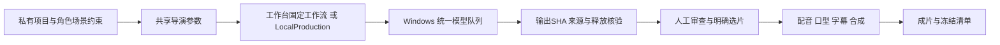

# 本地 AIGC 制作模块

> 更新日期：2026-10-16
> 状态：制作链路已接通；当前创作范围和质量结论以 [开发计划](../04-开发计划.md) 为准。

## 两种执行入口

工作台保存按tenant/subject隔离的项目和素材，修改需要当前revision；执行时发布既有WorkflowService的不可变定义，由Temporal持有依赖和等待，授权、审批及副作用账本由AgentOS裁定。单镜头只派发该镜头，整组生成串行执行。候选来源和选片与项目版本分别保存，旧运行可回查。

离线入口 `python -m agentos.adapters.aigc.local` 使用相同Project、Director和媒体适配器，将材料、作业、参数指纹、审查和选片存入本地项目。LocalProduction逐阶段执行，不依赖Temporal；操作方需要继续驱动阶段和审查。当前30秒实例走此入口，部分字幕另有后处理，不能称网页全程一键制作。

## 制作阶段与配方

结构化制作依次支持 `cards → harmonize → keyframes → endframes → speak → animatic → generate → lipsync → compose`。阶段按项目需要执行；角色/场景卡记录身份、服装、布局、材质，分镜记录站位、视线、起止动作与物件状态。首尾帧独立绑定和审查，动态规划通过后才生成运动。图生图完成只代表候选，不等于身份或画风通过。

配方复用已安装的ComfyUI图。Klein、Qwen编辑、源参考清理、Wan图生视频与首尾引导作为明确配方分别保存，不因某配方是代码默认就覆盖已批准项目。参考清理可使用精确mask/ROI；支持原尺寸返回及mask外像素保护，参数和源SHA进入追溯记录，局部修补仍须检查材质。源静帧和声音条件须明确记载；当前实例原视频片段和原音轨禁止拼入生成成片。

Wan运动可选择既有四步加速或20步质量配方，首尾引导保留不同条件；不把动作失败改成静态推拉充数。资源和原生帧数按已登记配方限制，由原统一调度器准入，服务端不能靠客户端自报超时绕过工具契约。角色、动作、画布或参考变动会使旧候选的生产签名失效，需要显式新尝试。

短剧与桌宠复用FFmpeg、FFprobe和Pillow。桌宠背景分离采用既有模型，保留原manifest定位与比例，封装透明PNG、并排颜色/alpha视频和命中素材；不以逐动作包围框改变角色大小。短剧逐段明确选片后再合成。

配音为可选已登记CLI，不在核心包安装权重或推理环境，不在运行中自动下载模型。IndexTTS worker通过既有数组接口输出PCM，在原生clamp前可比例保护峰值；音量、ASR正确或零削波均不能证明角色音色和剧情演技合格。

口型要求已选视频、说话者ROI及该镜头的对白窗口。跨镜同句使用source_start截取正确窗口；完整原生视频按目标时间轴重定时后再口型，合成不重复加速。个人30fps JoyVASA profile按真实时间映射25Hz音频动作并保留非活跃帧，仅限制lip变化和静音动作；它不等于音素识别或所有CG角色均合格。MuseTalk等实现均须实际看脸部细节和边界后选用。

`retime_native` 将完整原生视频保首尾映射到计划整数帧数；普通trim/still保留原策略。重定时、插帧或放大不增加已生成的动作信息。混音逐句放置等长PCM后再分批混合，避免稀疏延迟输入错位；全段重定时影片的音轨长度取整数总帧/fps，不取可能截断尾样本的容器显示时长。字幕支持烧录、mov_text和单独SRT；配音不足补静音，字幕结束不截掉末镜。

## 来源、恢复与访问边界

图片和音视频上传上限64MiB，校验文件头；图片同时检查格式及像素上限。控制面只传输当前主体授权的Asset，节点引用由服务端派生；调用方不能指定内部文件引用。节点接收和输出都校验SHA-256，本地材料路径限制在项目根内。

适配器先持久化参数指纹、输入SHA、版本化图和稳定UUID，再交给统一队列。断线或超时先查同一UUID的原生history、作业和输出，核验释放后再恢复，不盲目新建任务。相同生产键输入变化明确拒绝；真正改变提示或参考必须显式新尝试。交付失败只按原作业补传，不重新生成。结果复用前重验字节。

技术完成与审查分别记录，默认pending；accepted/rejected需要实际审查，影片不会因作业completed自动最终通过。选片核对所属项目、完成状态、来源运行和当前生产参数。运行状态通过授权项目接口查询，不暴露任意节点内部作业工具。

离线导出仅包含当前主体授权材料、标准参数、制作说明和标准图，不含部署配置、凭据或模型；总量上限512MiB。导出/重导入不能继承未经复核的生成质量评价。冻结已有成片时保存选片参数、当前素材SHA、worker/配方pin和实际合成回执；容器SHA与视频/音频内容等同性分别核验。

## 接口和复用取舍

- `/v1/aigc/catalog`：当前制作工具和引擎状态。
- `/v1/aigc/materials`：授权媒体上传。
- `/v1/aigc/projects`：私有项目，保存使用expected_revision。
- `/v1/aigc/projects/{id}/start`：固定项目版本和阶段，使用稳定幂等键。
- `/v1/aigc/projects/{id}/runs`：本项目运行和已完成节点成果。

复用ComfyUI执行模型图、统一调度器进行互斥准入、Temporal持久化工作台依赖、DraftService乐观修订、AssetService归属与传输、FFmpeg编码。自研限于配方适配、制作记录、导演参数、表单和素材桥接，没有新增GPU调度器、图引擎或媒体数据库。退出可使用标准图、PNG/WAV/MP4/SRT和JSON。模型、第三方节点及权重遵循各自许可证，均不随核心源码分发。

## 当前验证与质量边界

核心完整测试762通过、6跳过，其中289项AIGC专项；Ruff、104文件mypy、3项导入架构、15个契约和依赖检查通过。前端实际build/typecheck、4项编辑器测试及相关JS语法检查通过。合成测试用于授权、恢复、时钟及边界；真实Win回执、媒体和完整质量审查留部署方受保护目录。模拟浏览器不替代物理手机验证。

当前30秒实例20新运动段与单段正式口型已合成，900帧/30fps、1280×720；选中原生视频为524帧、432p/16fps。使用者接受画面基线并指出变身特效不流畅；仅首句声音方向可保留，其余12句被实际听审拒绝。当前固定视觉流程，后续先逐角色声音/演技，再1080p。此状态不代表最终声音、音素同步、运动相似度或完整一集验收通过，不输出未经标定的相似度百分比。

模型推理由Win原FIFO队列执行，保留预算、超时、输入上限和受管后代释放核验，不另起后端、不清他人队列。status的策略文字不等于释放证据，必须查verified/process_count等实测字段；仅覆盖受管子进程，不能据此关闭用户其他程序。
