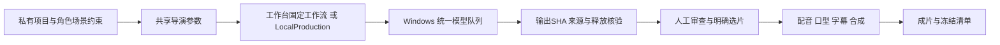

# 本地 AIGC 制作模块

> 更新日期：2026-10-29
> 状态：制作链路已接通；当前创作范围和质量结论以 [开发计划](../04-开发计划.md) 为准。

## 两种执行入口

工作台保存按tenant/subject隔离的项目和素材，修改需要当前revision；执行时发布既有WorkflowService的不可变定义，由Temporal持有依赖和等待，授权、审批及副作用账本由AgentOS裁定。单镜头只派发该镜头，整组生成串行执行。候选来源和选片与项目版本分别保存，旧运行可回查。

离线入口 `python -m agentos.adapters.aigc.local` 使用相同Project、Director和媒体适配器，将材料、作业、参数指纹、审查和选片存入本地项目。LocalProduction逐阶段执行，不依赖Temporal；操作方需要继续驱动阶段和审查。当前30秒实例走此入口，部分字幕另有后处理，不能称网页全程一键制作。

## 制作阶段与配方

结构化制作依次支持 `cards → harmonize → keyframes → endframes → speak → animatic → generate → lipsync → compose`。阶段按项目需要执行；角色/场景卡记录身份、服装、布局、材质，分镜记录站位、视线、起止动作与物件状态。首尾帧独立绑定和审查，动态规划通过后才生成运动。图生图完成只代表候选，不等于身份或画风通过。

配方复用已安装的ComfyUI图。Klein、Qwen编辑、源参考清理、Wan图生视频与首尾引导作为明确配方分别保存，不因某配方是代码默认就覆盖已批准项目。参考清理可使用精确mask/ROI；支持原尺寸返回及mask外像素保护，参数和源SHA进入追溯记录，局部修补仍须检查材质。源静帧和声音条件须明确记载；当前实例原视频片段和原音轨禁止拼入生成成片。

Wan运动可选择既有四步加速或20步质量配方，首尾引导保留不同条件；不把动作失败改成静态推拉充数。资源和原生帧数按已登记配方限制，由原统一调度器准入，服务端不能靠客户端自报超时绕过工具契约。角色、动作、画布或参考变动会使旧候选的生产签名失效，需要显式新尝试。

短剧与桌宠复用FFmpeg、FFprobe和Pillow。桌宠背景分离采用既有模型，保留原manifest定位与比例，封装透明PNG、并排颜色/alpha视频和命中素材；不以逐动作包围框改变角色大小。短剧逐段明确选片后再合成。

配音为可选已登记CLI，不在核心包安装权重或推理环境，不在运行中自动下载模型。IndexTTS worker通过既有数组接口输出PCM，在原生clamp前可比例保护峰值；音量、ASR正确或零削波均不能证明角色音色和剧情演技合格。

口型要求已选视频、说话者ROI及该镜头的对白窗口。跨镜同句使用source_start截取正确窗口；完整原生视频按目标时间轴重定时后再口型，合成不重复加速。个人30fps JoyVASA profile按真实时间映射25Hz音频动作并保留非活跃帧，仅限制lip变化和静音动作；它不等于音素识别或所有CG角色均合格。MuseTalk等实现均须实际看脸部细节和边界后选用。

`retime_native` 将完整原生视频保首尾映射到计划整数帧数；普通trim/still保留原策略。重定时、插帧或放大不增加已生成的动作信息。混音逐句放置等长PCM后再分批混合，避免稀疏延迟输入错位；全段重定时影片的音轨长度取整数总帧/fps，不取可能截断尾样本的容器显示时长。字幕支持烧录、mov_text和单独SRT；配音不足补静音，字幕结束不截掉末镜。

## 来源、恢复与访问边界

图片和音视频上传上限64MiB，校验文件头；图片同时检查格式及像素上限。控制面只传输当前主体授权的Asset，节点引用由服务端派生；调用方不能指定内部文件引用。节点接收和输出都校验SHA-256，本地材料路径限制在项目根内。

适配器先持久化参数指纹、输入SHA、版本化图和稳定UUID，再交给统一队列。断线或超时先查同一UUID的原生history、作业和输出，核验释放后再恢复，不盲目新建任务。相同生产键输入变化明确拒绝；真正改变提示或参考必须显式新尝试。交付失败只按原作业补传，不重新生成。结果复用前重验字节。

技术完成与审查分别记录，默认pending；accepted/rejected需要实际审查，影片不会因作业completed自动最终通过。选片核对所属项目、完成状态、来源运行和当前生产参数。运行状态通过授权项目接口查询，不暴露任意节点内部作业工具。

离线导出仅包含当前主体授权材料、标准参数、制作说明和标准图，不含部署配置、凭据或模型；总量上限512MiB。导出/重导入不能继承未经复核的生成质量评价。冻结已有成片时保存选片参数、当前素材SHA、worker/配方pin和实际合成回执；容器SHA与视频/音频内容等同性分别核验。

## 接口和复用取舍

- `/v1/aigc/catalog`：当前制作工具和引擎状态。
- `/v1/aigc/materials`：授权媒体上传。
- `/v1/aigc/projects`：私有项目，保存使用expected_revision。
- `/v1/aigc/projects/{id}/start`：固定项目版本和阶段，使用稳定幂等键。
- `/v1/aigc/projects/{id}/runs`：本项目运行和已完成节点成果。

复用ComfyUI执行模型图、统一调度器进行互斥准入、Temporal（或单进程 local 引擎）持久化工作台依赖、DraftService乐观修订、AssetService归属与传输、FFmpeg编码。自研限于配方适配、制作记录、导演参数、表单和素材桥接，没有新增GPU调度器、图引擎或媒体数据库；可选的显卡互斥只在部署声明对话端点与生成节点共用一张卡时防止两者同时占卡，不排队或调度节点任务。退出可使用标准图、PNG/WAV/MP4/SRT和JSON。模型、第三方节点及权重遵循各自许可证，均不随核心源码分发。

## 工作室（一键短剧）

工作室把同一模块包装成从梗概到成片的创作界面：写剧本、提取角色与场景、拆分镜、定妆、出分镜画面、配音、生成动态和口型，最后在控制面合成带字幕与混音的成片。它不另建作业队列或媒体库，取舍见 [ADR-0026](../03-架构决策.md#adr-0026)。

| 环节 | 复用的核心能力 |
| --- | --- |
| 项目 | DraftService 私有草稿（kind `studio`）；项目编辑有独立版本号，选片和评分不打断正在输入的编辑 |
| 生成 | 每次请求发布一个 FlowGraph 并启动运行；出图/视频/配音/口型是节点工具节点，逐步经过策略、审批或预授权、账本和审计 |
| 导演与合成 | 服务端注册的 custom 节点 `studio_director`、`studio_render`，以运行时刷新的身份读写草稿和 Asset |
| 一键制作 | 剧本 → 分镜 → 定妆 → 配音 → 画面（含首尾帧的尾帧）→ 动态 → 导出，每阶段一个运行，末尾的 `studio_next` 用稳定幂等键启动下一阶段；缺参考音等前提不足的项目跳过并说明 |
| 候选与选片 | 从运行输出和上传读回；未明确选择时使用第一个候选（成片取最新），可选择“不使用” |
| 参数 | 由所选素材规划：分镜画面引用所选角色、场景和画风参考图，动态引用所选画面，配音引用角色参考音，口型引用所选动态与配音时间。参数在发布时固定，候选可追溯到所用素材 |

部署方配置：`studio_enabled` 打开工作室；`studio_node_id` 指定已配对的生成节点；生成需要工作流引擎（`workflow_engine = "local"` 适合单进程，或连接 Temporal）；`studio_ffmpeg` 可指定控制面的 FFmpeg。对话端点与生成节点共用显卡时设置端点 `gpu_shared` 和 `accelerator_nodes`。

媒体工具默认每步审批。所有者可在工作室或设备页预授权节点的制作工具 8 小时到 7 天，随时撤销（[ADR-0027](../03-架构决策.md#adr-0027)）；已在等待的审批仍需逐项裁定。节点调用出错时步骤进入待核对，界面提供“核对并继续”，按同一幂等键接回节点结果，或取消这一批后重试。

接口：`/v1/studio/overview`（节点、引擎、权限与队列）、`/v1/studio/projects`（项目、上传、选片、生成、导演、导出、一键制作）、`/v1/studio/jobs`（取消整批、重试）、`/v1/studio/events`（进度事件）、`/v1/studio/media/{asset}`（短时签名媒体链接与缩略图/预览派生）。开发可用 `scripts/dev_mock_node.py` 与 `scripts/dev_mock_ollama.py` 在无显卡环境走通整条链路，它们只产生合成占位媒体。

## 当前验证与质量边界

工作室的合成证据：`tests/integration/test_studio.py` 用按核心节点工具契约应答的假节点和脚本化导演覆盖审批、预授权、选片来源、核对重放、取消重试、一键串联与导出；`tests/unit/test_studio_plan.py` 校验规划参数符合节点工具 schema。这些不代表真实模型画面、配音或运动质量。

核心完整测试762通过、6跳过，其中289项AIGC专项；Ruff、104文件mypy、3项导入架构、15个契约和依赖检查通过。前端实际build/typecheck、4项编辑器测试及相关JS语法检查通过。合成测试用于授权、恢复、时钟及边界；真实Win回执、媒体和完整质量审查留部署方受保护目录。模拟浏览器不替代物理手机验证。

当前30秒实例20新运动段与单段正式口型已合成，900帧/30fps、1280×720；选中原生视频为524帧、432p/16fps。使用者接受画面基线并指出变身特效不流畅；仅首句声音方向可保留，其余12句被实际听审拒绝。当前固定视觉流程，后续先逐角色声音/演技，再1080p。此状态不代表最终声音、音素同步、运动相似度或完整一集验收通过，不输出未经标定的相似度百分比。

模型推理由Win原FIFO队列执行，保留预算、超时、输入上限和受管后代释放核验，不另起后端、不清他人队列。status的策略文字不等于释放证据，必须查verified/process_count等实测字段；仅覆盖受管子进程，不能据此关闭用户其他程序。
