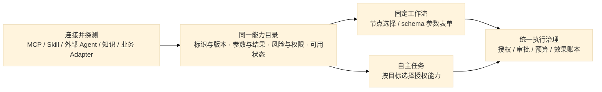

# 能力接入模块：发现、节点与自主选择

产品目标是能力接入一次后，工作流和自主任务都能在授权范围内使用。部署地址、设备和实现不决定能力分类；总图见 [总体架构](../01-总体架构.md)。本页明确区分代码现状与下一步设计。

## 1. 当前代码核对

| 用户关心的问题 | 当前行为 | 尚缺什么 |
| --- | --- | --- |
| 核心单独启动、默认 UI | FastAPI 同源工作台、API、入站 MCP 默认装配；没有 Temporal 地址也能启动 | 真实 AI 仍需安装 Codex 并配置模型；可视编辑器需构建 |
| 不部署知识库 | 不需要 WeKnora，默认内置 SQLite 知识后端 | 没有 `knowledge=disabled`；知识工具/路由仍装配 |
| 接入 MCP 自动发现 | 注册时官方 SDK initialize + tools/list，缓存名称、描述和参数 schema | 变化通知与自动健康刷新未实现；目前探针/刷新更新目录 |
| 工作流能选已接入能力 | `/v1/workflows/catalog` 列出工具，编辑器工具节点可选择 `server:tool` | API 只返回名称/描述；参数需高级 JSON，未生成 schema 表单；目录不是实时同步 |
| 自定义节点 | 服务端注册 Adapter 后出现在 custom 节点选项 | 不是任意远端节点插件；不能直接接入任意代码执行 |
| 不配置工作流也能做事 | 普通任务进入 Codex，工具目录含 schema，经 dynamicTools 自主选择 | 不会自动选择已发布工作流或任意外部 Agent；Skill 仍需安装及任务固定版本 |
| 其他 Agent 帮用户接入 | 入站 MCP 有提交/状态/取消/知识检索/技能列表 | 没有能力接入向导、配置探针/注册/预览的 MCP 管理工具 |

代码定位：`apps/config.py`、`apps/composition.py`、`apps/gateway.py`、`apps/mcp_server.py`、`adapters/tools/mcp_hub.py`、`runtime/agent_driver.py`、`frontend/workflow/src/editor.tsx`。以上是源码核对，不冒充新增真实模型验证。

## 2. 下一步统一接入设计（未实现）

这是薄集成层的改动方案，不另写执行循环或通用工作流引擎。MCP 继续用官方 SDK 发现，Skill 继续用 Agent Skills 格式，Codex 自主决策，Temporal 承载固定流程。工作流编辑器复用 React Flow；表单应选成熟 JSON Schema 表单组件，按许可与兼容验证确定实现，不能把本设计写成已完成。

能力描述至少包含稳定 ID、来源和版本、输入/输出 schema、风险、所需权限、健康状态与运行时引用。目录只对调用者展示允许发现的范围，派发时再次核权。目录更新影响新节点/新任务，已发布流程和运行绑定原版本；断开或版本不兼容时明确提示，不静默改绑。

工作流节点种类保持少量基础执行语义。MCP 工具、知识检索、Skill 或外部 Agent 作为可选能力呈现在节点面板中，不需要每接入一个工具新增一种引擎节点。Skill 是做法和资源，并不天然是可执行函数；没有执行契约时只允许读取，不能伪造工具化支持。

## 3. 两条执行入口

- 用户选定流程：固定已发布版本，校验参数，交给 Temporal，副作用经平台 executor。
- 用户只给目标：Codex 从调用者可用能力中选择工具；下一步将可调用工作流/外部 Agent 用受控 Adapter 暴露，保持预算、恢复与取消归属明确。

平台不能自动安装陌生程序、访问任意地址或从材料中采纳凭据。接入管理也应采用“发现/探针 → 配置草稿 → 用户确认具体连接与权限 → 应用”的步骤；入站 MCP 暴露相同的受控管理入口，让其他 Agent 可辅助填写与检查。

## 4. 授权不是唯一条件

已经授权且低风险的动作无需每步询问；新增写入、执行、费用或数据出域按策略申请具体审批。账号权限不足、额度不足、服务不可达、参数不合法或结果未知，分别拒绝、暂停、补参数或对账。模型不能替用户扩大权限，也不能绕过预算和平台策略。

实施工作单与状态统一见 [开发计划](../04-开发计划.md)，本页不维护第二份完成清单。
