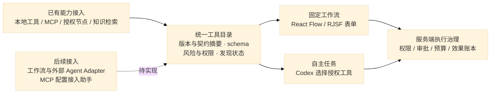

# 能力接入模块：发现、节点与自主选择

产品目标是能力接入一次后，工作流和自主任务都能在授权范围内使用。总图见 [总体架构](../01-总体架构.md)。本轮 CAP-01 完成工具目录、知识关闭与工作流表单；工作流/外部 Agent 自主选择和接入助手仍后置。

## 1. 当前装配与发现

| 场景 | 当前行为 | 边界 |
| --- | --- | --- |
| 最小核心 | 同源 UI、HTTP、入站 MCP、任务及治理；Temporal 不必配置 | 真实 AI 需要 Codex 与模型端点；编辑器需 build |
| 不使用知识 | `knowledge_backend="disabled"` / `AGENTOS_KNOWLEDGE_BACKEND=disabled` | 不装配知识后端、不绑定新任务、不提供 knw.search 或入站 knowledge_search；知识操作明确 unsupported，数据不删除 |
| 可选服务失败 | 知识服务不在启动时联机；Temporal 启动连接有 5 秒上限，失败后普通任务/UI/MCP 继续可用 | Temporal 启动失败恢复需服务恢复后重启核心；不自动切换知识后端 |
| MCP 工具发现 | 注册使用官方 SDK initialize/tools/list；目录读取时按连接 60 秒 TTL 自动发现，单连接 3 秒上限；管理探针可立即刷新 | 没有常驻 list_changed 订阅；发现状态不是每次调用成功保证 |
| 节点发现 | 配对节点经现有 /tools 探针刷新；失败保留缓存描述并标不可用 | 不可用工具不注入模型、不允许新派发；停用/撤销仍服务端核对 |
| 工作流编辑 | React Flow 节点画布，RJSF 6.11.0 + AJV8 参数表单，15 秒轮询及窗口重新聚焦刷新 | 复杂输入映射仍在高级配置；刷新不会覆盖草稿或已发布版本 |

关闭知识是部署级决定，适用于旧任务后续检索；重新启用不会删除或迁移已有数据。能力中心显示未启用，隐藏摄取/检索按钮。知识 capabilities 查询仍可读取配置状态；其他知识 HTTP 操作明确失败，不能返回空结果冒充查询成功。

## 2. 统一工具目录与治理

`services/capabilities.py` 是现有 ToolPort 的薄治理装饰器。`/v1/capabilities/catalog` 与 `/v1/workflows/catalog` 返回同一工具描述，Codex 从同一目录获得可用 ToolSpec。描述包含名称、版本、输入/输出 schema、风险、恢复方式、超时、所需 scope、契约 revision、发现状态与 available。知识关闭、MCP 停用、节点撤销和主体权限变化在这些入口保持一致。Skill 仍按固定版本读取资源，不伪装成任意函数。

发现结果按 tenant 和身份 scope 过滤，guest 不获得执行目录。风险 scope 不足的工具不提供给模型；具备 scope 不表示已获副作用审批。每次派发仍刷新身份、校验参数、检查策略/预授权、预算与账本。不可用连接缓存 schema 供编辑诊断，但不会注入模型。

状态 `local` 表示进程内能力，`refreshed` 表示本轮发现成功，`cached` 表示未新探测的缓存，`unavailable` 表示发现失败。发现不执行业务工具，不保证服务随后的可达性。自动刷新失败只保留安全状态，不将服务端异常原文放进目录。

## 3. 发布、版本与恢复

HTTP 发布由服务端校验图并写入工具/AI 节点的 `capability_bindings`，不接受客户端伪造摘要。revision 包含版本、schema、风险和恢复契约，发现健康状态不改变摘要。重新发布生成不可变版本；运行和审批恢复前检查契约，变化则明确要求重新发布，禁止静默改绑。已确认成功的工具步骤按账本回放，不因为能力后来改变而重复产生效果。

该绑定适用于本轮后的 HTTP 发布版本。已有无绑定的历史定义保持兼容；需要契约保护时检查并重新发布。内部使用 WorkflowService 的 Adapter 应先调用同一 bind_graph，不以直接调用服务绕过固定契约。

编辑器同步目录只更新可选能力，不改已有节点参数；已停用/权限不足/未发现的选项显示提示，契约变化显示重新发布提示。RJSF 根据 JSON Schema 生成表单，AJV 校验普通参数，执行时服务端 jsonschema 仍为权威。包含 `$ref` 输入映射的参数保留高级编辑，不由表单覆盖。异常 schema 的表单显示诊断并保留高级入口。

## 4. 自主任务与后续扩展

用户只给目标时，Codex 可从当前授权工具中选择；用户选定流程时，固定发布版本交给 Temporal。工作流/外部 Agent 成为可调用能力、入站 MCP 发现/探针/配置草案/确认应用仍未实现。

平台不能从材料中采纳凭据或自动安装陌生程序。接入助手后续采用“探测 → 配置草案 → 确认具体连接与权限 → 应用”，复用现有治理。项目、组织额度与 IM 按真实企业需求扩展。

## 5. 复用与验证

继续复用 Codex、官方 MCP SDK、Temporal、React Flow；表单复用 [RJSF](https://github.com/rjsf-team/react-jsonschema-form)（Apache-2.0，React >=18）与 AJV8，不自研 schema 表单引擎。额外成本是编辑器按需 bundle 增大；许可和锁定版本记录在组件清单。退出时保留标准 JSON Schema、HTTP 描述和流程 JSON，只替换 UI 表单层。

合成服务和确定性机制检查见 `tests/integration/test_capability_catalog.py`，覆盖关闭知识、目录权限、自动刷新/失败隔离、停用拒绝、固定契约/重启、Temporal 启动失败及 AgentRuntime 工具参数派发。合成引擎不是本轮真实模型调用证据；状态与待办统一见 [开发计划](../04-开发计划.md)。
