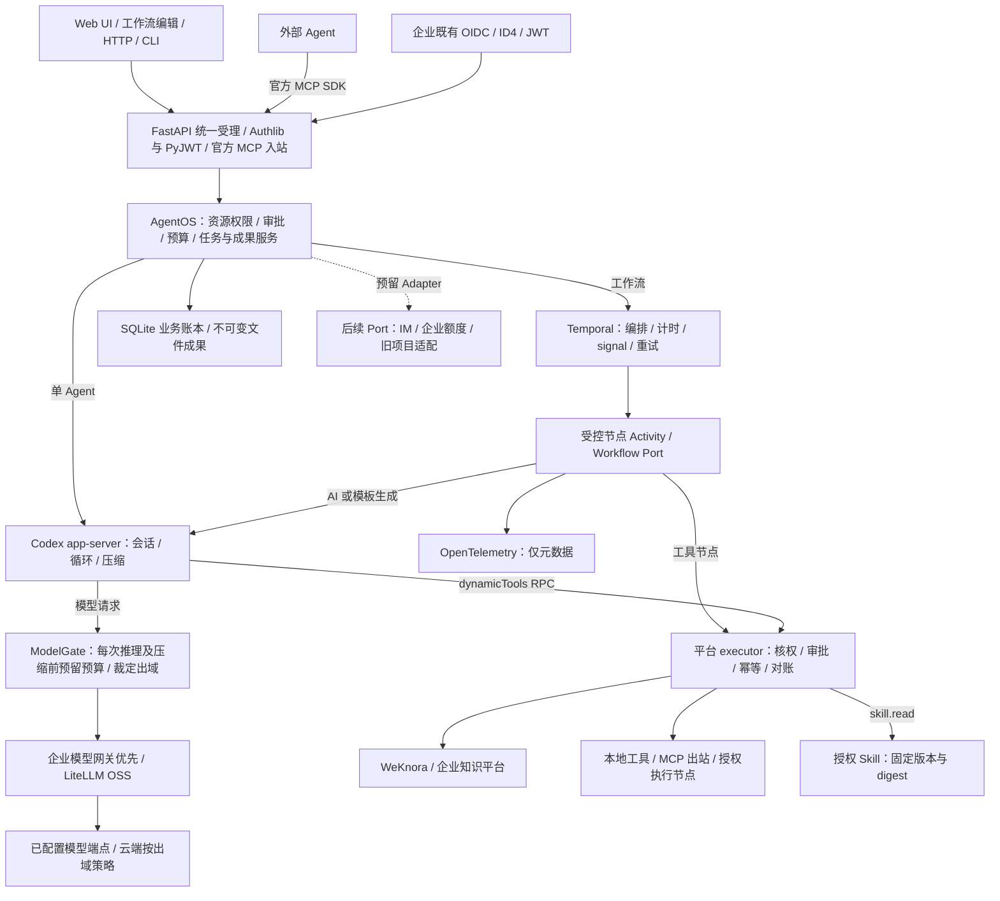
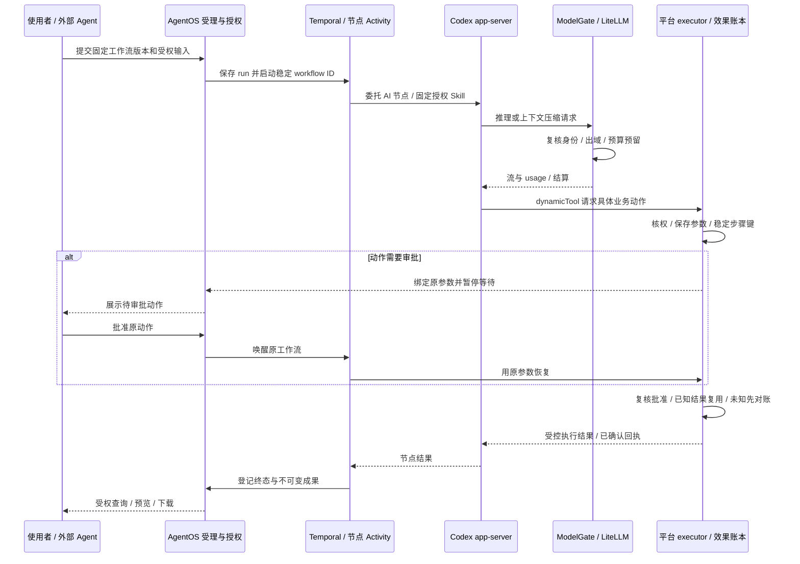

# 执行模块：引擎、编排与治理

本文说明当前实现细节；系统分层与部署形态见 [总体架构](../01-总体架构.md)。具体模块图不作为部署拓扑。

## 1. 组件调用关系

Temporal 是持久图工作流依赖；普通 Codex 任务可不接入 Temporal。模型端点可以部署于任意可达位置。知识实现当前为内置或 WeKnora，企业项目/额度/渠道图中虚线只表示预留 Port，未代表真实接入。

## 2. 单次工具动作与恢复

每次推理及压缩都经过 ModelGate。审批绑定保存的工具参数；恢复继续原调用，不重新生成参数。未知结果先核对，不通过重试假定成功。Codex 的原生工具关闭，平台工具经受控 executor 执行；控制面只读沙箱不等于远程系统已具备企业强隔离。

## 3. 代码定位

| 部分 | 代码 |
| --- | --- |
| 装配与模型闸门 | `apps/composition.py`、`services/model_gate.py` |
| Codex 协议与线程 | `adapters/runtime/codex.py`、`runtime/agent_driver.py` |
| Temporal 编排 | `adapters/workflow/temporal.py`、`runtime/workflow_driver.py` |
| 副作用与恢复 | `runtime/executor.py`、`services/access.py` |

通用引擎复用 Codex/Temporal，平台保留业务权限、审批、幂等和成果约束。业务策略与状态语义见 [工程设计](../02-工程设计.md)。
